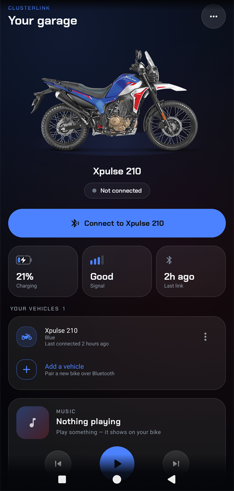
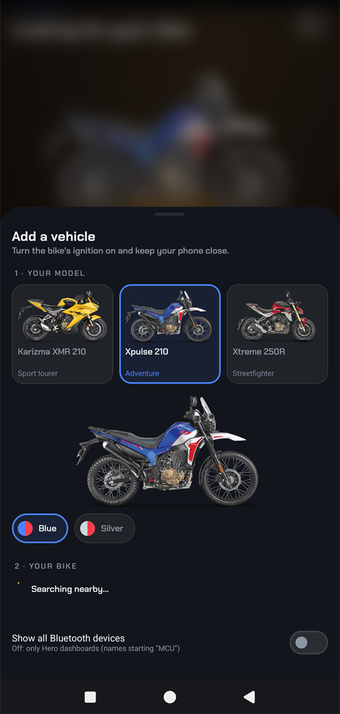
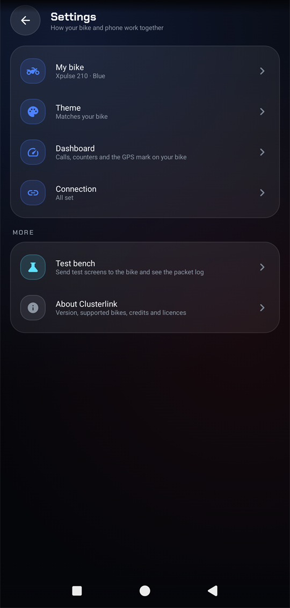
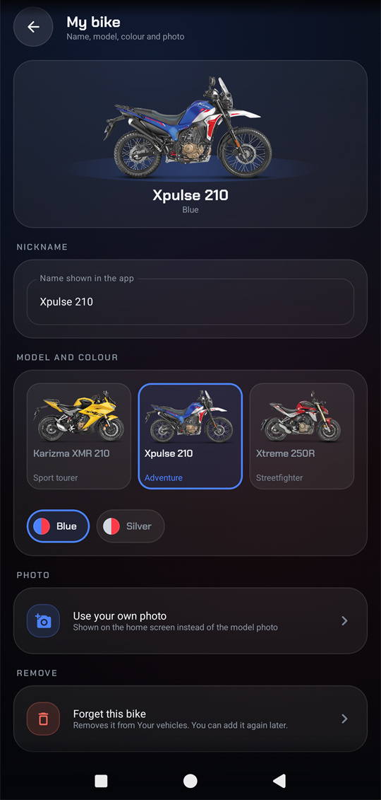
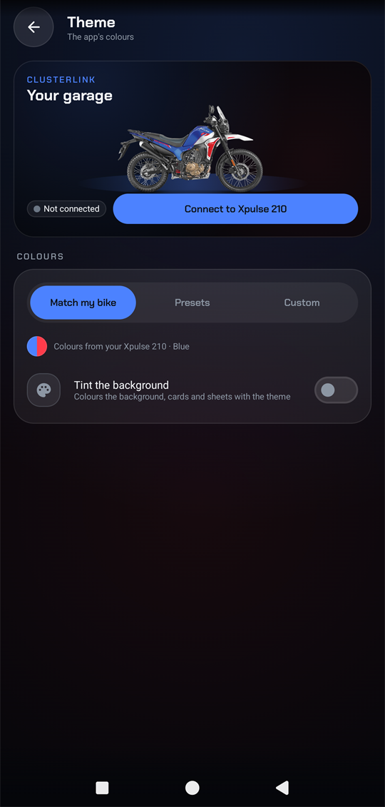
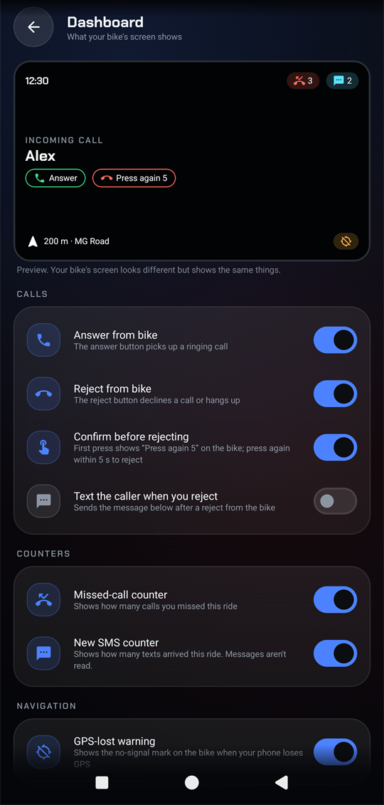
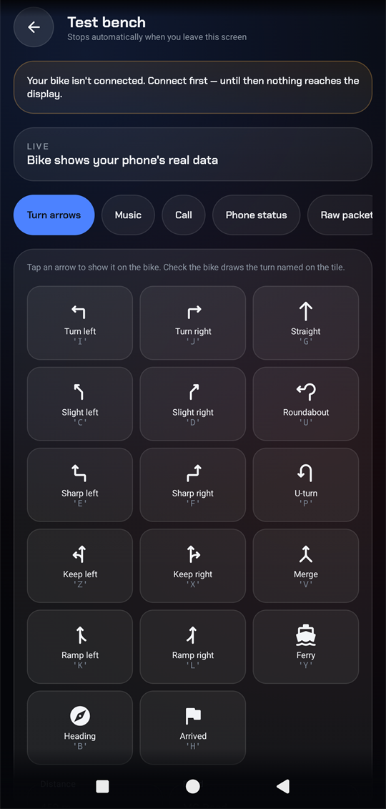
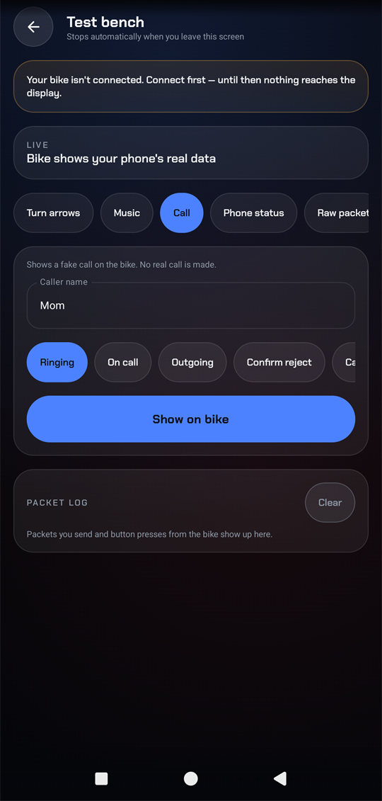
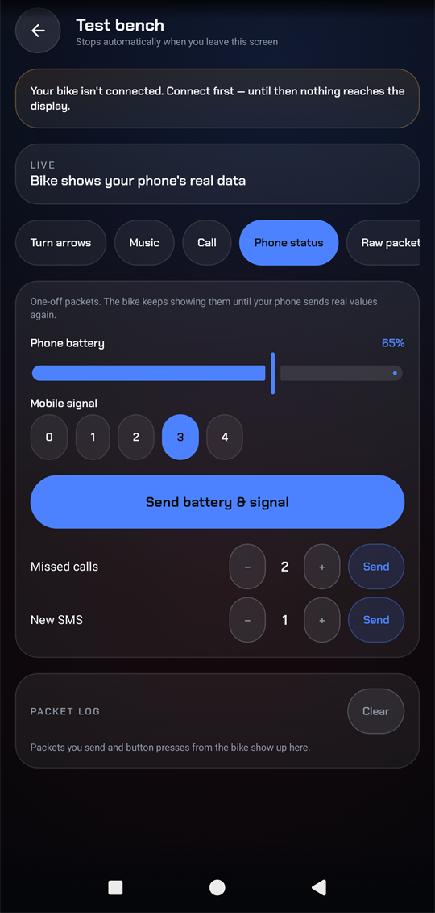

<picture>
  <source media="(prefers-color-scheme: dark)" srcset="docs/branding/clusterlink-wordmark.svg">
  
</picture>

# Clusterlink

Android app that shows your calls, music, Google Maps directions and phone status on the Bluetooth TFT
dashboard of **Hero motorcycles**. No account, no cloud, no analytics.

> Not affiliated with Hero MotoCorp. In development, no release yet. Don't use the app while riding.

<p align="center">
  
  &nbsp;
  
  &nbsp;
  
</p>
<p align="center">
  
  &nbsp;
  
  &nbsp;
  
</p>
<p align="center">
  
  &nbsp;
  
  &nbsp;
  
</p>
<p align="center"><sub>Bike images © Hero MotoCorp, shown for illustration only.</sub></p>

## Features

- **Navigation** from Google Maps: turn arrow, distance, road, arrival time, and a GPS-lost warning.
- **Calls**: caller name and call timer; answer or reject from the handlebar, with optional
  confirm-before-reject and an auto-reply SMS.
- **Music**: song, artist, progress and volume; play, pause and skip from the handlebar.
- **Phone status**: battery, signal, and missed-call and SMS counters.
- **Your bike's colours**: pick your model and colour edition and the app matches it, or choose a preset
  or your own colours.
- **Auto-reconnect** when the bike powers on, plus a Quick Settings tile.
- **Updates itself** from this repo's GitHub releases.
- **Test bench** to try every screen on the bike without a real call, song or route.

## Supported bikes

Hero bikes with a Bluetooth TFT dashboard. Built-in models: **Karizma XMR 210**, **Xpulse 210** and
**Xtreme 250R**. Developed on a Karizma XMR CE; connection and music are confirmed on the bike, the rest is
not yet tested on it.

## Build and install

Needs JDK 17–21, Android SDK 34 and Gradle 8.9 (or Android Studio). Runs on Android 8.0+.

```bash
cp local.properties.sample local.properties   # set sdk.dir
gradle :app:assembleDebug
adb install -r app/build/outputs/apk/debug/app-debug.apk
```

`MAPS_API_KEY` in `local.properties` is optional (only for the in-app map card).

## Bike photos

The bike photos are Hero's images. Release APKs include them; the source code doesn't, so a build from
source shows a bike symbol instead. To add them, put WebP files in `app/src/main/res/drawable-nodpi/` with
the names listed in `core/BikeModel.kt` (for example `bike_xpulse_210_blue.webp`).

## Permissions

| Permission | Why |
|---|---|
| Nearby devices (Bluetooth) | Find and connect to the bike |
| Phone, call log, contacts | Caller name and call state |
| Answer calls | Answer / reject from the handlebar |
| SMS (receive, optional send) | SMS counter; optional reply when you reject |
| Notification access | Google Maps directions and music |
| Location | GPS-lost warning while navigating |
| Internet | Maker profile on the About page, optional map |

## How it works

The dashboard speaks a simple text protocol over Bluetooth Low Energy. Clusterlink reads Google Maps'
navigation notification, the active media session and phone state, and sends short packets to the
dashboard every 800 ms. Details: [PROTOCOL.md](PROTOCOL.md) and
[docs/original-app-analysis.md](docs/original-app-analysis.md).

## Credits

- Made with help from [Claude](https://www.anthropic.com/claude) (Anthropic).
- Font: [Chakra Petch](https://github.com/m4rc1e/Chakra-Petch), SIL Open Font License
  ([licence](docs/licenses/ChakraPetch-OFL.txt)).
